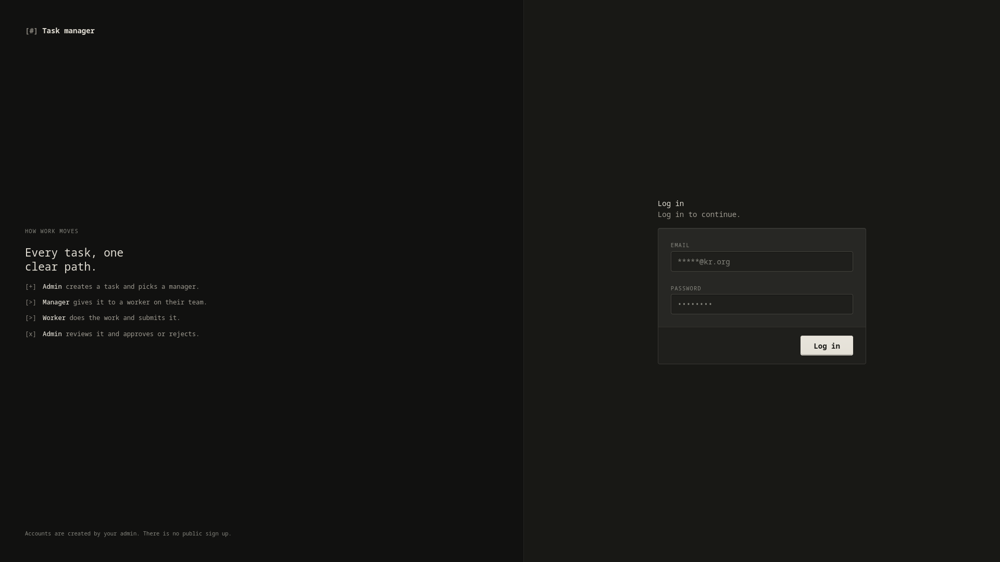
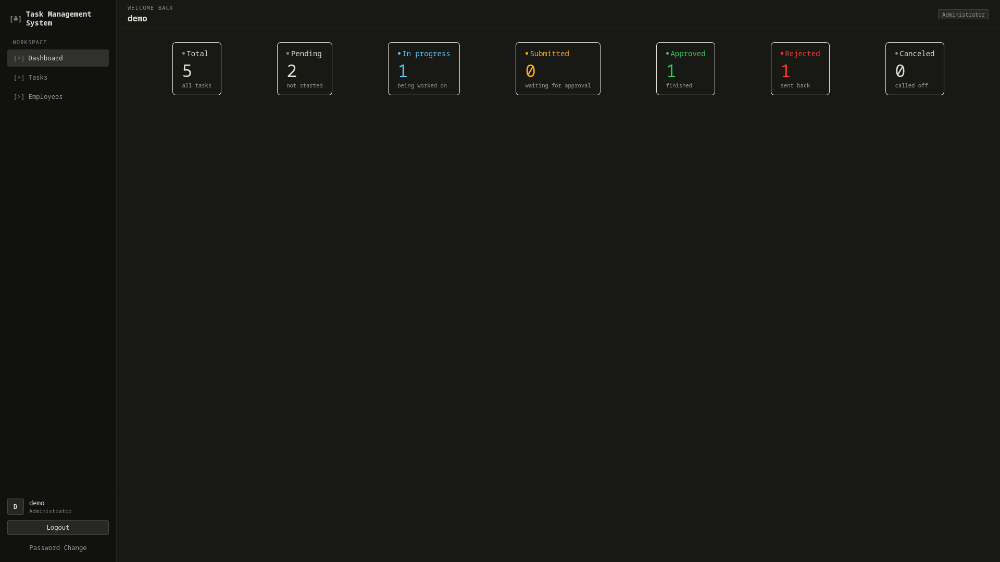
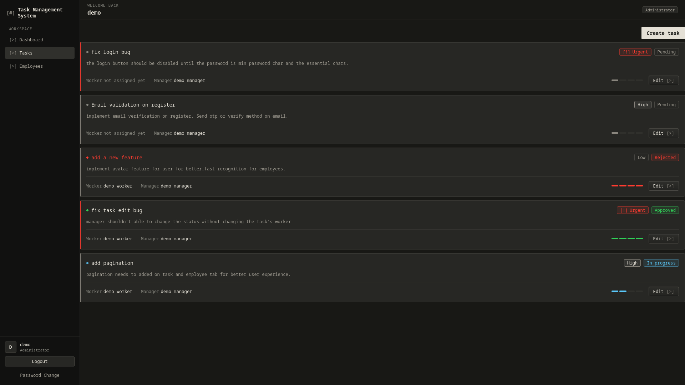
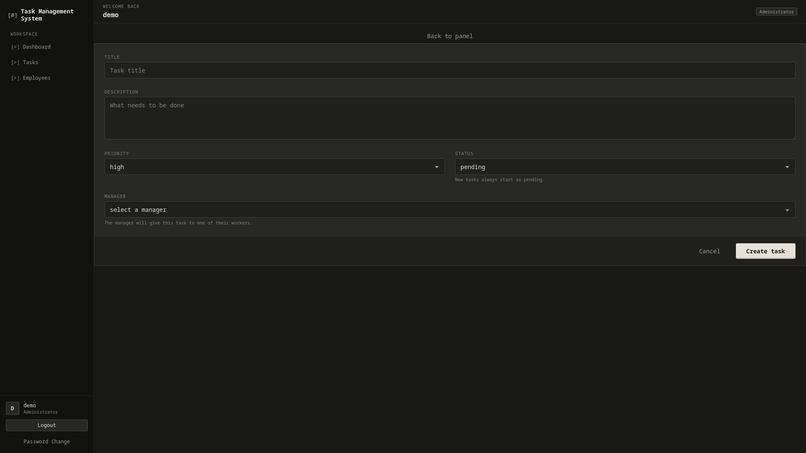
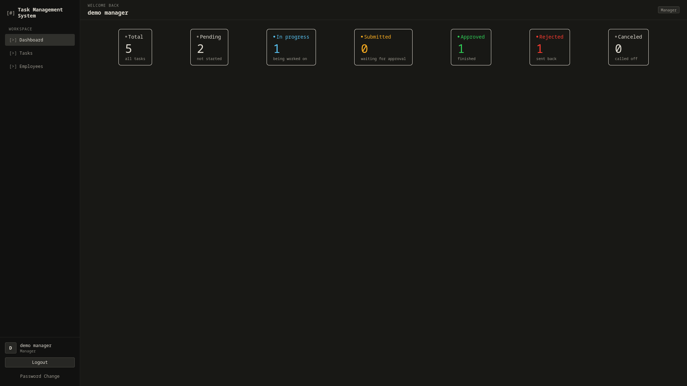
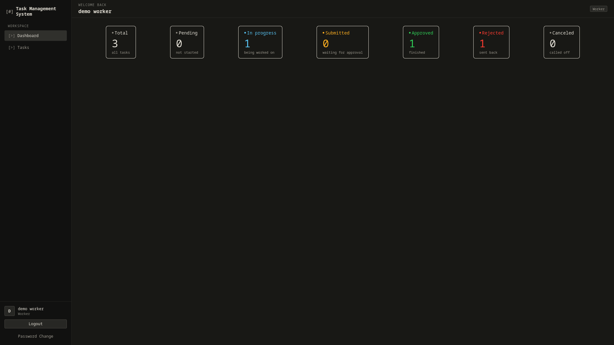
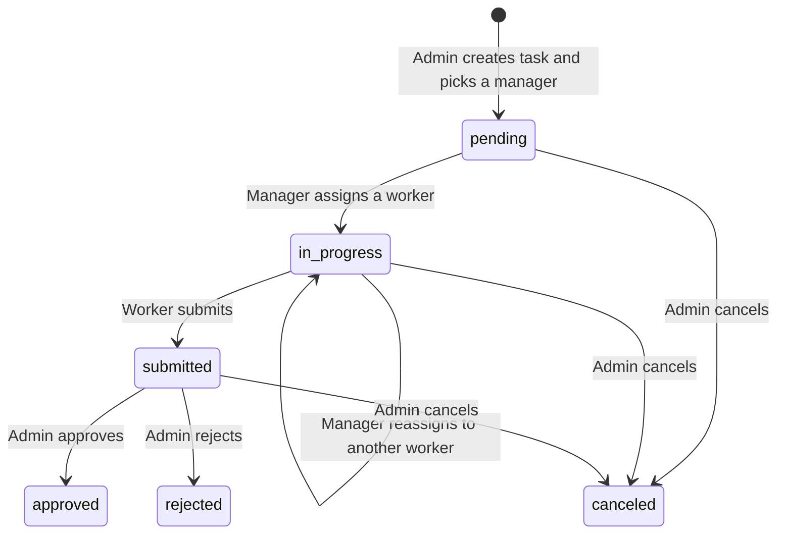

# Task Management System

A role-based task app I built to learn what a "real" full-stack project looks like. An admin creates a task and picks a manager, the manager hands it to a worker, the worker submits it, and the admin approves or rejects it.

The part I cared about most: every rule is enforced on the server. Hiding a button in the UI is not security, so the API checks who you are, what you own, and what state the task is in, no matter what the frontend sends.

**Live demo:** https://task-management-system-ytjg.onrender.com

> The backend runs on Render's free tier and goes to sleep when idle, so the first login can take 30 to 60 seconds. After that it's fast.

## Try it

There's no public sign-up (the admin creates accounts), so here are three demo accounts. The data is throwaway, so feel free to click around.

| Role | Email | Password |
| --- | --- | --- |
| Admin | demo.admin@khabiruzzaman.xyz | 12345678 |
| Manager | demo.manager@khabiruzzaman.xyz | 12345678 |
| Worker | demo.worker@khabiruzzaman.xyz | 12345678 |

Please don't change these passwords, since it logs out the next person who tries them. The login page shows a different example domain in the placeholder, but use the emails above.

A good way to see the whole flow: log in as the admin and create a task, then log in as the manager and assign it, then as the worker and submit it, then back as the admin to approve it.

## Screenshots

| | |
| --- | --- |
|  |  |
| Login | Admin dashboard |
|  |  |
| Admin task list | Creating a task |
|  |  |
| Manager dashboard | Worker dashboard |

## How it works



Approved, rejected and canceled are final. Title, description, priority and manager can only be changed while a task is still `pending`.

| Action | Admin | Manager | Worker |
| --- | :---: | :---: | :---: |
| Register users, promote, demote, build teams | yes | | |
| Create tasks | yes | | |
| Edit, cancel, approve or reject | yes (own tasks) | | |
| Assign a task to a worker | | yes (own team) | |
| Submit a task | | | yes (own tasks) |
| See tasks | ones they created | ones they manage | ones assigned to them |

## What I focused on

- **Authorization on the server.** Role middleware (`adminify`, `managerify`, `workerify`) guards the routes, and the services check ownership again. An admin can only touch tasks they created, a manager only tasks they manage, a worker only tasks assigned to them.
- **Status rules in one place.** The allowed transitions for each role live in the service layer. A request that tries an invalid move gets a 403, even if someone calls the API directly.
- **Session handling.** The access token is short-lived and kept in memory. The refresh token sits in an httpOnly cookie, is rotated on every refresh, and is stored hashed (SHA-256) in the database. The frontend refreshes quietly when a token expires and makes sure parallel requests don't trigger several refreshes at once.
- **Rate limiting** on login (failed attempts only, per IP and email), register, password change, and a global limit.
- **A closed system.** Only emails on the configured organisation domain can log in, and only the admin can create accounts. Changing your password ends your session, and you can't promote or demote someone who still has active tasks.

## Tech stack

| | |
| --- | --- |
| Frontend | React 19, Vite, React Router 7, Tailwind CSS 4, plus a small custom CSS design system |
| Backend | Node.js, Express 5, Mongoose 9 |
| Database | MongoDB Atlas |
| Auth and security | JWT (access and refresh), bcryptjs, cookie-parser, CORS, express-rate-limit |
| Hosting | Render (frontend and backend), MongoDB Atlas |

## Run it locally

You need Node.js 20.19+ (or 22.12+) and a MongoDB database. The Atlas free tier is enough.

```bash
git clone https://github.com/khabiruzzaman-dev/task-management-system.git
cd task-management-system
```

**Backend**

```bash
cd backend
npm install
cp .env.example .env     # fill in your own values
npm run seed:admin       # creates the first admin from the ADMIN_* values
npm start                # http://localhost:3000
```

**Frontend** (in a second terminal)

```bash
cd frontend
npm install
cp .env.example .env
npm run dev              # http://localhost:5173
```

Log in as the seeded admin, register a manager and a worker, promote the manager, then put the worker on the manager's team.

### Environment variables

Backend (`backend/.env`):

| Variable | What it's for |
| --- | --- |
| `PORT` | API port, e.g. 3000 |
| `MONGODB_URI` | MongoDB connection string |
| `ACCESS_TOKEN_SECRET_KEY`, `ACCESS_TOKEN_EXPIRY` | Access token secret and lifetime (e.g. `15m`) |
| `REFRESH_TOKEN_SECRET_KEY`, `REFRESH_TOKEN_EXPIRY` | A different secret for refresh tokens, and lifetime (e.g. `15d`) |
| `ORG_DOMAIN` | Only emails on this domain can log in or be registered |
| `CLIENT_URL` | Frontend origin allowed by CORS |
| `NODE_ENV` | `development` or `production` (production turns on secure cross-site cookies and proxy trust) |
| `ADMIN_NAME`, `ADMIN_EMAIL`, `ADMIN_PASSWORD` | Only used by `npm run seed:admin` |

Frontend (`frontend/.env`): `VITE_API_URL`, the API base URL, e.g. `http://localhost:3000/api`.

The real `.env` files are git-ignored. Only the `.env.example` templates are committed.

## API

Everything lives under `/api`. All routes except login, token refresh and the health check need an `Authorization: Bearer <accessToken>` header.

| Method | Route | Who | What it does |
| --- | --- | --- | --- |
| GET | `/health` | public | Health check |
| POST | `/authentication/login` | public | Log in, returns an access token and sets the refresh cookie |
| POST | `/authentication/refresh-tokens` | refresh cookie | Rotate tokens |
| DELETE | `/authentication/logout` | any user | Invalidate the refresh token |
| GET | `/authentication/get-me` | any user | Current user |
| PATCH | `/authentication/change-pass` | any user | Change your password (ends the session) |
| POST | `/authentication/register-user` | admin | Create a user (starts as a worker) |
| PATCH | `/user/admin/promote` | admin | Worker to manager |
| PATCH | `/user/admin/demote` | admin | Manager to worker |
| PATCH | `/user/admin/assign-worker` | admin | Put a worker on a manager's team |
| GET | `/user/admin/get-employee-list` | admin | Managers and workers this admin registered |
| GET | `/user/manager/get_worker-list` | manager | Workers on the manager's team |
| POST | `/task/create-task` | admin | Create a task |
| GET | `/task/get-tasks` | any user | Tasks visible to your role |
| PATCH | `/task/task-admin` | admin | Edit, change manager, approve, reject, cancel |
| PATCH | `/task/task-manager` | manager | Assign a worker |
| PATCH | `/task/task-worker` | worker | Submit work |

## Project structure

```
backend/
  config/          env and database setup
  features/        admin, authentication, manager, task, user
                   (each: route -> controller -> service -> model)
  middleware/      auth, role guards, rate limiters
  utils/           token helpers, cookie options, shared error and response classes
  scripts/         seed_admin.js
frontend/
  src/
    ash/           design tokens and component styles
    components/    shared UI (task card, stats, sidebar, buttons)
    context/       auth, tasks, employees, workers, toasts
    pages/         admin, manager, worker, authentication, home
    utils/         fetch wrapper with automatic token refresh
```

## What's missing

I'd rather say it than hide it:

- No automated tests yet. The status-transition rules are the first thing I'd cover.
- No request body validation yet (I plan to add Zod).
- A worker can't be moved to another manager once assigned.
- No pagination or search on the lists.
- No email verification or "forgot password".
- Rejected tasks are final, with no rework loop.

Ideas for later: due dates, comments and activity history on tasks, notifications.

## Author

Built by Khabiruzzaman. [GitHub](https://github.com/khabiruzzaman-dev) · [LinkedIn](https://www.linkedin.com/in/khabiruzzaman)

## License

MIT. See [LICENSE](LICENSE).
