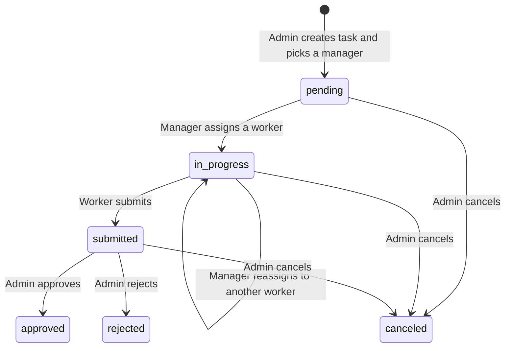

# Task Management System

A full-stack, role-based task workflow app built with the MERN stack. An **admin** creates tasks and assigns them to a **manager**, the manager hands them to a **worker**, the worker submits the result, and the admin approves or rejects it. Every rule is enforced on the server, not just hidden in the UI.

**Live demo:** TODO add link
**Demo login:** TODO add a throwaway demo account (never a real one)

<!-- TODO: add 2-3 screenshots, e.g. docs/screenshots/admin-dashboard.png -->
<!--  -->

## Highlights

- **Server-enforced role-based access control.** Dedicated middleware (`adminify`, `managerify`, `workerify`) guards every route, and each service checks ownership too (an admin can only edit tasks they created, a manager only tasks they manage, a worker only tasks assigned to them).
- **Task status state machine.** Allowed transitions are defined per role in the service layer. Invalid transitions are rejected with `403`, whatever the UI sends.
- **Hardened session handling.** Short-lived access token kept in memory, refresh token in an `httpOnly` cookie, refresh tokens rotated on every refresh and stored **SHA-256 hashed** in the database. The frontend silently refreshes on expiry and de-duplicates concurrent refresh calls.
- **Rate limiting** with `express-rate-limit`: per IP + email on login (failed attempts only), per user on register and password change, plus a global limit.
- **Safe account lifecycle.** Changing a password invalidates the session. Promoting or demoting is blocked while the user has active tasks.
- **Closed system.** No public sign-up. The admin creates accounts, and only emails on the configured organisation domain can log in.

## Features

- Three roles with separate dashboards: admin, manager, worker
- **Admin:** create tasks, edit details while pending, cancel, approve or reject submitted work, register users, assign workers to managers, promote workers and demote managers
- **Manager:** see tasks assigned to them and give each one to a worker on their team (can be changed while the task is pending or in progress)
- **Worker:** see their own tasks and submit finished work for review
- Per-role dashboards with task statistics, toast notifications, change-password flow

## Tech stack

| Layer | Tools |
| --- | --- |
| Frontend | React 19, Vite, React Router 7, Tailwind CSS 4, custom CSS design system ("ASH") |
| Backend | Node.js, Express 5, Mongoose 9 |
| Database | MongoDB (Atlas) |
| Auth and security | JWT (access + refresh), bcryptjs, cookie-parser, CORS, express-rate-limit |

## Task workflow



- Task details (title, description, priority) and the manager can only be changed while the task is `pending`. Changing the manager clears the assigned worker.
- `approved`, `rejected` and `canceled` are final.

## Roles and permissions

| Action | Admin | Manager | Worker |
| --- | :---: | :---: | :---: |
| Register users | yes | - | - |
| Promote / demote / assign workers to managers | yes | - | - |
| Create tasks | yes | - | - |
| Edit details, change manager, cancel, approve, reject | yes (own tasks) | - | - |
| Assign a task to a worker | - | yes (own team) | - |
| Submit a task | - | - | yes (own tasks) |
| View tasks | tasks they created | tasks they manage | tasks assigned to them |
| Change own password | yes | yes | yes |

## Getting started

### Prerequisites

- Node.js 20.19+ or 22.12+
- A MongoDB database ([MongoDB Atlas](https://www.mongodb.com/atlas) free tier works)

### 1. Clone

```bash
git clone https://github.com/<your-username>/task-management-system.git
cd task-management-system
```

### 2. Backend

```bash
cd backend
npm install
cp .env.example .env        # then fill in real values (see "Environment variables")
npm run seed:admin          # creates the first admin from ADMIN_* in .env
npm start                   # API on http://localhost:3000
```

### 3. Frontend

```bash
cd frontend
npm install
cp .env.example .env
npm run dev                 # app on http://localhost:5173
```

Log in with the seeded admin, then register a manager and a worker from the admin dashboard. New users start as workers: promote one to manager, then assign workers to that manager.

## Environment variables

**Backend (`backend/.env`)**

| Variable | Purpose |
| --- | --- |
| `PORT` | API port (example: 3000) |
| `MONGODB_URI` | MongoDB connection string |
| `ACCESS_TOKEN_SECRET_KEY` / `ACCESS_TOKEN_EXPIRY` | Access token secret and lifetime (e.g. `15m`) |
| `REFRESH_TOKEN_SECRET_KEY` / `REFRESH_TOKEN_EXPIRY` | Refresh token secret (different from the access secret) and lifetime (e.g. `15d`) |
| `ORG_DOMAIN` | Only emails on this domain can log in or be registered |
| `CLIENT_URL` | Frontend origin allowed by CORS |
| `NODE_ENV` | `development` or `production` (production enables secure cross-site cookies and proxy trust) |
| `ADMIN_NAME`, `ADMIN_EMAIL`, `ADMIN_PASSWORD` | Used only by `npm run seed:admin` |

**Frontend (`frontend/.env`)**

| Variable | Purpose |
| --- | --- |
| `VITE_API_URL` | Base URL of the API, e.g. `http://localhost:3000/api` |

Real `.env` files are git-ignored. Only the `.env.example` templates are committed.

## API overview

All routes are prefixed with `/api`. Everything except login, token refresh and the health check needs an `Authorization: Bearer <accessToken>` header.

| Method | Route | Access | Description |
| --- | --- | --- | --- |
| GET | `/health` | public | Health check |
| POST | `/authentication/login` | public | Log in, returns access token and sets refresh cookie |
| POST | `/authentication/refresh-tokens` | refresh cookie | Rotate tokens |
| DELETE | `/authentication/logout` | any user | Invalidate the refresh token |
| GET | `/authentication/get-me` | any user | Current user |
| PATCH | `/authentication/change-pass` | any user | Change own password (ends the session) |
| POST | `/authentication/register-user` | admin | Create a user (starts as worker) |
| PATCH | `/user/admin/promote` | admin | Worker to manager |
| PATCH | `/user/admin/demote` | admin | Manager to worker |
| PATCH | `/user/admin/assign-worker` | admin | Put a worker on a manager's team |
| GET | `/user/admin/get-employee-list` | admin | Managers and workers registered by this admin |
| GET | `/user/manager/get_worker-list` | manager | Workers on the manager's team |
| POST | `/task/create-task` | admin | Create a task |
| GET | `/task/get-tasks` | any user | Tasks visible to the caller's role |
| PATCH | `/task/task-admin` | admin | Edit, change manager, approve, reject, cancel |
| PATCH | `/task/task-manager` | manager | Assign a worker |
| PATCH | `/task/task-worker` | worker | Submit work |

## Project structure

```
backend/
  config/            env + database setup
  features/
    admin/ authentication/ manager/ task/ user/
      route/ controller/ service/ model/   # route -> controller -> service -> model
  middleware/        auth, role guards (adminify, managerify, workerify), rate limiters
  utils/             token generation and hashing, cookie options, shared error/response classes
  scripts/           seed_admin.js
frontend/
  src/
    ash/             design tokens and component styles
    components/      shared UI (task card, stats, sidebar, buttons)
    context/         auth, tasks, employees, workers, toasts
    pages/           admin/ manager/ worker/ authentication/ home/ (layout, controller, service)
    utils/           fetch wrapper with automatic token refresh
```

## Known limitations and roadmap

- A worker cannot be unassigned from or moved between managers once assigned
- No request body schema validation yet (planned: Zod)
- No automated tests yet (planned: tests for the status-transition rules)
- Email verification and "forgot password" are not implemented
- Rejected tasks are final (no rework loop)
- No pagination or search on task lists
- Planned: comments and activity history on tasks, due dates, notifications

## Author

Built by TODO your name ([GitHub](https://github.com/<your-username>) · [LinkedIn](TODO)).

## License

TODO: add a LICENSE file (MIT is a common choice for portfolio projects).
